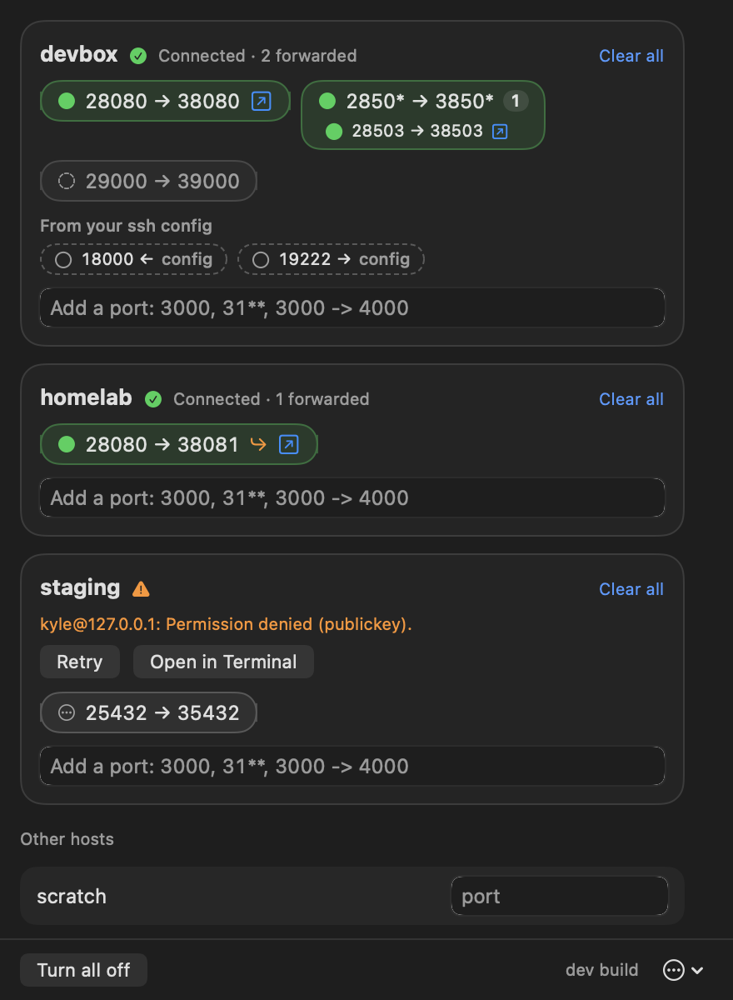

# fwd: SSH port forwarding for the macOS menu bar

fwd keeps remote ports reachable on your Mac's `localhost`. Pick a host from
your `~/.ssh/config`, type `3000`, and `http://localhost:3000` reaches port
3000 on that machine. Close the lid, walk away, come back: the forwards are
re-established without you touching anything.



- **No setup.** Hosts come from your ssh config. If `ssh devbox` works in a
  terminal, `devbox` works in fwd.
- **Ranges.** `3***` forwards whatever is listening between 3000 and 3999,
  following servers as they start and stop.
- **Never "port already in use".** If the laptop port is taken, fwd uses the
  next free one and tells you.
- **Shows what's alive.** Each port shows whether a server is listening on
  the remote and whether a connection is open through it.
- **Recovers by itself.** Sleep, lid close and network changes are handled.

## Requirements

- macOS 26 or later on Apple Silicon.
- Key-based ssh login that works without prompting (keys in the agent or the
  keychain). fwd never asks for a password; a host that needs one shows
  "needs attention" with an **Open in Terminal** button so you can sort it out.

## Install

### Homebrew (recommended)

```sh
brew install kylefritz/tap/fwd
fwd
```

Homebrew builds fwd on your machine, so macOS has nothing to block. Update
with `brew upgrade fwd`; the app tells you when a new version is out.

### Download

Get `fwd.zip` from the [latest release](https://github.com/kylefritz/fwd/releases/latest),
unzip it and move `fwd.app` to `/Applications`.

fwd is not notarized by Apple, so macOS blocks a downloaded copy the first
time. Either:

- open it once, then go to **System Settings → Privacy & Security** and click
  **Open Anyway**, or
- run `xattr -dr com.apple.quarantine /Applications/fwd.app`

A downloaded copy updates itself: it checks GitHub, downloads the new version
in the background and offers **Restart to update**.

### From source

Needs only Apple's Command Line Tools (`xcode-select --install`).

```sh
git clone https://github.com/kylefritz/fwd && cd fwd
make install   # builds, copies fwd.app to /Applications, links ~/.local/bin/fwd
```

## Using it

Click the arrow in the menu bar. Each host from your ssh config has a field;
type a port and press Return.

| You type | What you get |
|---|---|
| `3000` | remote 3000 on `localhost:3000` |
| `3000 -> 4000` | remote 3000 on `localhost:4000` |
| `31**` | every listening remote port from 3100 to 3199, same number locally |
| `3*** -> 4***` | every listening remote port from 3000 to 3999, shifted to 4000 to 4999 |

Add a name after the port to label it: `3000 api`, `3000 -> 4000 web`.
Right-click a pill → **Rename…** to change it later.

`*` stands for one digit and goes at the end. The left side is always the
remote port. Local ports below 1024 aren't allowed (`80 -> 8080` is fine).

Each entry becomes a pill. Click it to turn it off or on; hover for the
remove button; the arrow icon opens it in your browser. Entries stay in the
host's history until you remove them or **Clear all**.

### Screen Sharing

Click the display icon next to a host to see its screen. fwd forwards the
remote's port 5900 to `localhost:5901` (5902 for the next host, and so on)
and opens it in macOS's built-in Screen Sharing app, with your ssh user name
filled in. It travels over the same ssh connection, so whatever already gets
you there (ProxyCommand, Cloudflare Access, a jump host) works unchanged.
The remote needs Screen Sharing turned on (System Settings → General →
Sharing), or any VNC server on port 5900.

What the pill's symbol means:

| Symbol | Meaning |
|---|---|
| dashed circle | off |
| hollow circle | forwarded, but nothing is listening on the remote yet |
| filled green circle | a server is listening on the remote |
| green bolt | a connection is open through it right now |
| orange triangle | blocked; hover for the reason |
| orange bent arrow | the local port you wanted was taken, so it moved to the one shown |

"In use right now" is a sample of open connections every few seconds. A
long-lived connection always shows; a single quick request may not.

### Forwards in your ssh config

If a host has `LocalForward` or `RemoteForward` lines in your ssh config, fwd
lists them as dashed "config" pills and shows whether they are currently in
effect. It never opens them itself; your own ssh sessions do that.

### From the terminal

`fwd` opens the window, starting the app if needed. `fwd --version` prints the
version. A Homebrew install has the command already; otherwise choose
**Install terminal command** from the ••• menu.

## When the connection drops

- fwd notices a dead link within about 15 seconds and retries after 2, 5, 15
  and 30 seconds, then once a minute.
- With no network, or while the Mac sleeps, it does nothing at all. It
  reconnects as soon as the Mac wakes or the network returns.
- If ssh needs you (key not loaded, unknown host key, expired sign-in), fwd
  stops retrying and shows **Retry** and **Open in Terminal**.

## Files

| File | What it is |
|---|---|
| `~/.config/fwd/ports.yaml` | Your entries. Safe to edit by hand or keep in dotfiles; changes apply within a second. |
| `~/.config/fwd/state.yaml` | Local ports fwd chose when yours were taken. Safe to delete. |
| `~/.config/fwd/config.yaml` | Preferences. `check_for_updates: false` turns off the update check. |
| `~/Library/Logs/fwd/fwd.log` | The log. **Copy log location** in the ••• menu copies its path. |

```yaml
# ~/.config/fwd/ports.yaml
hosts:
  devbox:
    - port: "3000"
      on: true
    - port: "3*** -> 4***"
      on: false
```

If `ports.yaml` can't be parsed, fwd says so, keeps running on the last good
version and leaves your file untouched. When fwd itself saves the file,
comments in it are lost.

## Privacy and trust

fwd makes two kinds of network connection: your own ssh sessions, and a
request to GitHub to check for a new release (which you can turn off). It
sends nothing else anywhere.

Updates are trusted because they come over HTTPS from this repository. They
are not signed with an Apple Developer ID.

## Troubleshooting

- **A host says "needs attention".** Click **Open in Terminal** and complete
  whatever ssh asks for, then **Retry**.
- **A wildcard says it can't scan the host.** The remote has none of `ss`,
  `netstat` or `lsof`. Single ports still work.
- **A port shows a bent arrow.** Something on your Mac already had that port.
  Turn the entry off and on to try the original port again.
- **Anything else.** `tail -f ~/Library/Logs/fwd/fwd.log` shows what fwd is
  doing. Include the relevant lines when you open an issue.

## How it works

fwd runs the system `ssh` with one background ControlMaster connection per
host, and adds and removes forwards on it as needed. Everything in your ssh
config (ProxyJump, ProxyCommand, certificates, hardware keys) therefore works
as it does in a terminal. A small script run over the same connection lists
the remote's listening ports.

## Development

```sh
make test   # unit tests, plus end-to-end tests against a throwaway local sshd
make app    # build/fwd.app
```

The tests start their own OpenSSH server on `127.0.0.1` as your user, with
generated keys in a temporary folder. No Docker, no root. Design notes are in
[docs/spec.md](docs/spec.md).

## License

MIT
