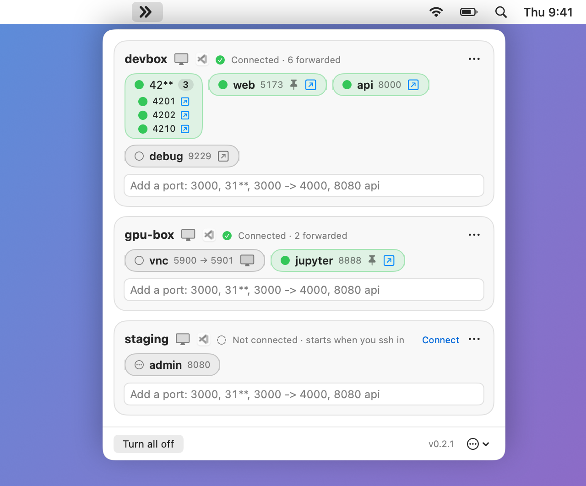

<div align="center">


# fwd

**SSH port forwarding that lives in your menu bar.**

Type `3000`, get `localhost:3000` from your dev box. No flags, no terminal tab to babysit.

[](https://github.com/kylefritz/fwd/releases/latest)
[](https://github.com/kylefritz/fwd/actions/workflows/ci.yml)

[](LICENSE)

[Install](#install) · [Using it](#using-it) · [When fwd connects](#when-fwd-connects) · [Troubleshooting](#troubleshooting)

<br>

<picture>
  <source media="(prefers-color-scheme: dark)" srcset="docs/screenshot-dark.png">
  
</picture>

</div>

## Why fwd

`ssh -L 3000:localhost:3000 devbox` works, until the laptop sleeps, the Wi-Fi
changes, a second server starts on 3001, or something local already has 3000.
fwd does the bookkeeping:

- 🔌 **Zero setup.** Hosts come straight from `~/.ssh/config`. If `ssh devbox`
  works in a terminal, it works in fwd, including ProxyJump, Cloudflare Access
  and hardware keys.
- ✳️ **Ranges.** `3***` forwards whatever is listening from 3000 to 3999, and
  follows servers as they start and stop.
- 🔀 **Never "address already in use".** If the laptop port is taken, fwd picks
  the next free one and shows you where it went.
- 🟢 **See what's alive.** Each port shows whether a server is listening on the
  remote and whether a connection is open through it right now.
- 🖥️ **One-click Screen Sharing.** Opens the remote's screen over the same ssh
  connection.
- 🤝 **Polite.** fwd connects while you're ssh'd into a host, or when you ask it
  to. It doesn't dial out on its own unless you pin a port to stay connected.

## Install

> [!NOTE]
> Needs macOS 26 or later on Apple Silicon, and ssh keys that log in without a
> prompt (in the agent or the keychain). fwd never asks for passwords.

**Homebrew** (recommended)

```sh
brew install kylefritz/tap/fwd
```

Homebrew builds fwd on your machine, so Gatekeeper has nothing to block.
Update with `brew upgrade fwd`; the app tells you when there's a new version.

**Download**

Grab `fwd.zip` from the [latest release](https://github.com/kylefritz/fwd/releases/latest),
unzip it, drag `fwd.app` into `/Applications`, then run:

```sh
xattr -dr com.apple.quarantine /Applications/fwd.app
```

fwd isn't notarized by Apple, so without that line macOS says it *"could not
verify fwd is free of malware"* the first time you open it. (Clicking **Open
Anyway** in **System Settings → Privacy & Security** works too.) After that, a
downloaded copy updates itself: it fetches new versions in the background
and offers **Restart to update**.

<details>
<summary>Build from source</summary>

Needs only Apple's Command Line Tools (`xcode-select --install`).

```sh
git clone https://github.com/kylefritz/fwd && cd fwd
make install   # builds, copies fwd.app to /Applications, links ~/.local/bin/fwd
```

A source build reports version `dev`, shows the commit it was built from at the bottom of the panel, and doesn't update itself.

</details>

## Using it

Click the fwd icon in the menu bar. Every host in your ssh config gets a
card; type a port into its field and press Return.

| You type | You get |
|---|---|
| `3000` | remote 3000 on `localhost:3000` |
| `3000 -> 4000` | remote 3000 on `localhost:4000` |
| `31**` | every listening remote port from 3100 to 3199, same numbers locally |
| `3*** -> 4***` | every listening remote port from 3000 to 3999, shifted to 4000 to 4999 |
| `3000 api` | the same, labelled `api` |

`*` stands for one digit and goes at the end. The left side is always the
remote port. Local ports below 1024 aren't allowed (`80 -> 8080` is fine).

Each entry becomes a pill. Click it to turn it off or on, click the arrow to
open it in your browser, and right-click for **Keep connected**, **Rename…**,
**Copy localhost:…** and **Remove**.

| Pill | Meaning |
|---|---|
| ◌ dashed circle | off |
| ○ hollow circle | forwarded, nothing listening on the remote yet |
| 🟢 green circle | a server is listening on the remote |
| ⚡ green bolt | a connection is open through it right now |
| 📌 pin | kept connected |
| ⚠️ orange triangle | blocked; hover for the reason |
| ↳ orange bent arrow | your laptop port was taken, so it moved to the one shown |

### Screen Sharing

Click the display icon on a host card. fwd forwards the remote's port 5900 to
`localhost:5901` (5902 for the next host, and so on) and opens it in macOS's
Screen Sharing app with your ssh user name filled in. When you close the
viewer, fwd turns the forward off again. The remote needs Screen Sharing on
(**System Settings → General → Sharing**) or any VNC server on 5900.

### From the terminal

The `fwd` command does what the panel does, so you, scripts and coding
agents can forward ports without clicking:

```sh
fwd devbox 3000           # forward devbox:3000, print http://localhost:3000
fwd 3000                  # the same, when devbox is the one connected host
fwd 3000 5173 web --keep  # several ports, with a name, kept connected
fwd wait 3000             # block until a server answers on devbox:3000
fwd status                # hosts and ports with their live state
fwd off 3000              # turn it off; fwd remove 3000 forgets it
fwd open                  # open the window
```

#### Tell your agent about fwd

Coding agents won't know fwd exists unless you tell them. Paste this into
your agent's instructions (`~/.claude/CLAUDE.md`, a project's `AGENTS.md`),
or run `fwd agents` to print it:

```markdown
## fwd: reaching servers on remote hosts

fwd forwards ports from ssh hosts to this Mac. Use it when something you
run here (a browser, curl, tests) needs a server on a remote host.

- `fwd <host> <port> --wait --json` forwards the port and waits until a
  server answers. The local URL is in `host.ports[0].url`; it can be a
  different local port than the remote one.
- `fwd status --json` lists hosts, their state and forwarded ports with
  URLs. Check it instead of guessing ports.
- `fwd <host> <port> --json` forwards without waiting (state `waiting`
  means nothing listens on the remote yet); `fwd wait <host> <port>`
  waits later.
- `fwd off <host> <port>` turns a forward off when you're done.
- The host can be left out when exactly one host is connected.
- Exit codes: 0 done, 1 couldn't (read `error`), 2 bad usage, 3 the fwd
  app isn't reachable, 4 timed out.
- Don't add `--keep` unless asked: it keeps the host connected after
  the session that started it ends.
- `fwd --help` lists everything.
```

The command starts fwd if it isn't running. Homebrew installs it; otherwise
choose **Install Terminal Command** in the ••• menu.

## When fwd connects

fwd holds a connection to a host only when something asks for one:

| Reason | Reconnects after a drop, sleep or network change? |
|---|---|
| You have `ssh <host>` open in a terminal | ✅ as long as your session lasts |
| A port on the host is set to **Keep connected** 📌 | ✅ always |
| You clicked: turned a port on, Screen Sharing, **Connect** | ❌ connects once |

Otherwise the card says *Not connected · starts when you ssh in* and offers
**Connect**. That way fwd never keeps knocking on a machine you've stopped
using, and never opens a sign-in page behind your back.

- A dead link is noticed within about 15 seconds. Retries come after 2, 5, 15
  and 30 seconds, then once a minute.
- Asleep or offline, fwd does nothing at all, and picks up again when the Mac
  wakes or the network returns.
- When ssh needs a person (key not loaded, unknown host key, a browser
  sign-in), fwd stops and shows **Retry** and **Open in Terminal**.

## Configuration

Everything lives in plain files, so it's easy to keep in your dotfiles.

| File | What it is |
|---|---|
| `~/.config/fwd/ports.yaml` | Your entries. Edit by hand if you like; changes apply within a second. |
| `~/.config/fwd/config.yaml` | Preferences: `check_for_updates: false` turns off update checks, `send_usage_stats: false` keeps them but stops the install count, `update_channel: beta` follows every build of `main`. |
| `~/.config/fwd/state.yaml` | Laptop ports fwd chose when yours were taken. Safe to delete. |
| `~/Library/Logs/fwd/fwd.log` | The log. **Show Log** in the ••• menu opens it; hold ⌥ for **Copy Log Location**. |

```yaml
# ~/.config/fwd/ports.yaml
hosts:
  devbox:
    - port: "5173"
      name: web
      keep: true        # stay connected without an ssh session
    - port: "3*** -> 4***"
      on: false
```

If `ports.yaml` can't be parsed, fwd says so, keeps running on the last good
version and leaves your file alone. Comments are lost when fwd saves the file.

## Troubleshooting

<details>
<summary><b>A host says "needs attention"</b></summary>

Click **Open in Terminal**, finish whatever ssh asks for (load a key, accept a
host key, sign in), then click **Retry**.

</details>

<details>
<summary><b>A host says "Not connected · starts when you ssh in"</b></summary>

That's expected: nothing asked for a connection. ssh into the host, click
**Connect**, or right-click a port and choose **Keep connected**.

</details>

<details>
<summary><b>A range says it can't scan the host</b></summary>

The remote has none of `ss`, `netstat` or `lsof`. Single ports still work.

</details>

<details>
<summary><b>A port shows a bent arrow</b></summary>

Something on your Mac already had that port. Turn the entry off and on to try
the original port again.

</details>

<details>
<summary><b>Anything else</b></summary>

Choose **Report a Bug…** in the ••• menu. Pick how much of the log to
include, check the preview, and fwd opens a prefilled GitHub issue. Sign-in
tokens, IP addresses and your home folder are always removed, and host
names can be. `tail -f ~/Library/Logs/fwd/fwd.log` shows what fwd is doing
as it happens.

</details>

## How it works

fwd drives the system `ssh`: one background ControlMaster connection per
host, with forwards added and removed on it as needed. Your ssh config applies
exactly as it does in a terminal. A small POSIX script run over the same
connection lists the remote's listening ports, and fwd reconciles the
forwards against it every few seconds.

**Privacy.** fwd talks to your hosts over ssh and asks GitHub whether there's
a new release. With each of those update checks it also sends a small ping
to `fwd.kylefritz.co` so I can count installs: a random install ID, the
version, the update channel, how fwd was installed and the macOS version,
plus your IP address as the request arrives. Nothing else leaves your Mac.
`send_usage_stats: false` stops the ping; `check_for_updates: false` stops
both. The ping is write-only: updates never depend on it. They come over HTTPS from this repository and are checked for the right bundle,
version and code signature before they're offered; they aren't signed with an
Apple Developer ID.

## Development

```sh
make test   # unit tests, plus end-to-end tests against a throwaway local sshd
make app    # build/fwd.app
```

The tests start their own OpenSSH server on `127.0.0.1` as you, with keys in a
temporary folder. No Docker, no root. Design notes live in
[docs/spec.md](docs/spec.md).

## License

[MIT](LICENSE)
